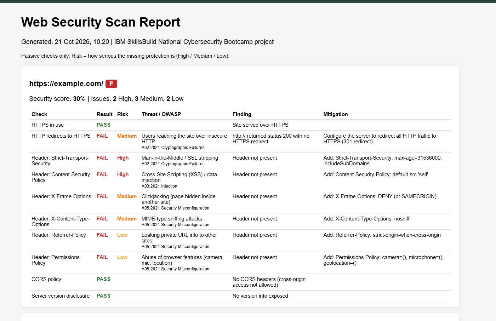
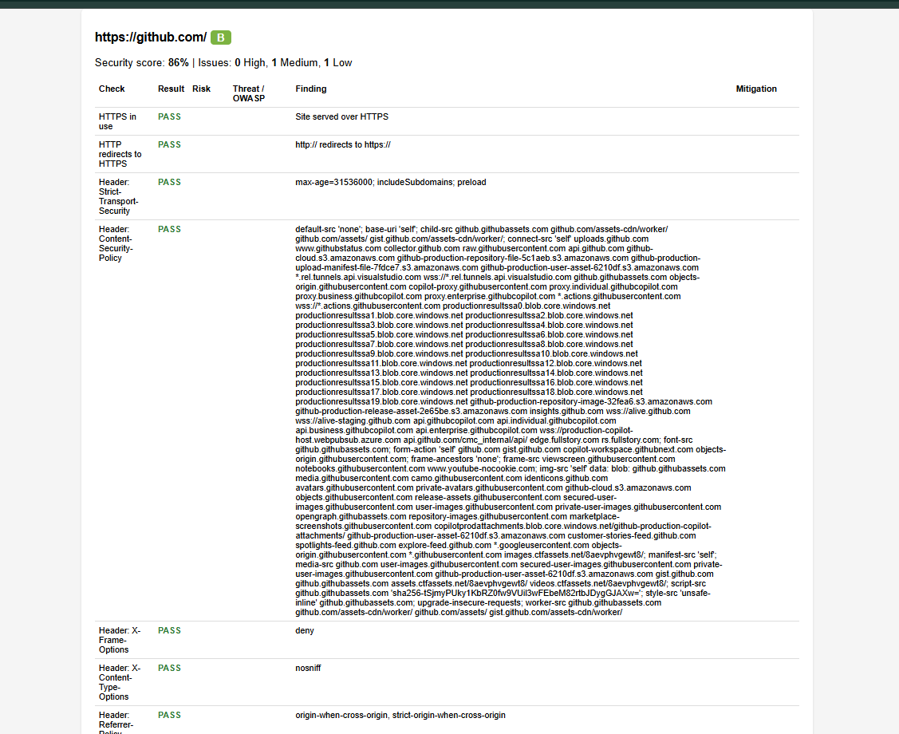
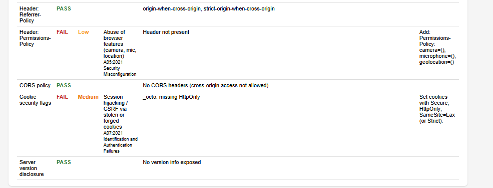
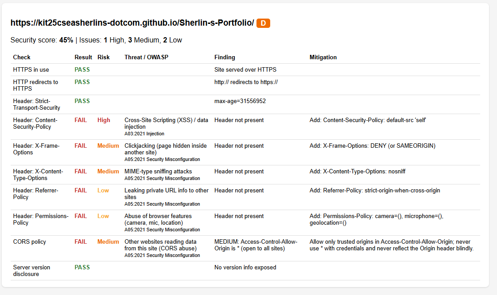

# Automated Web Security Scanner

A Python tool that automatically audits websites for missing HTTP security
headers, CORS misconfigurations, HTTPS problems, insecure cookies and
information disclosure. Each finding is explained as
**Threat -> Vulnerability -> Risk -> Mitigation** and mapped to the OWASP Top 10.

## About the Project
Developed for the **IBM SkillsBuild National Cybersecurity Bootcamp**
(5th to 19th October 2026), conducted online by **BharatCares (CSRBOX Group)**.

## Problem Statement
Many websites (college sites, small business sites, student projects) miss
basic protections such as Content-Security-Policy or HTTPS redirects. This
exposes them to XSS, clickjacking and man-in-the-middle attacks. This tool
finds these gaps quickly and tells the owner how to fix them.

## How this project connects to what I learned
| Concept learned in the bootcamp | How it appears in the project |
|---|---|
| Threats, vulnerabilities and risk management | Every finding shows the threat, a High/Medium/Low risk rating, and a mitigation |
| Phishing, scams and social engineering | Cookie flags and HTTPS checks reduce the impact of stolen sessions |
| Hacking 101: how cyber attacks work | XSS, clickjacking and MITM are the attacks these checks defend against |
| Ethical hacking | Passive, permission-based scanning only; no attacks performed |
| Secure configuration | Security headers, CORS and server hardening checks |

## Checks performed
- HTTPS in use and HTTP-to-HTTPS redirect
- 6 security headers: HSTS, CSP, X-Frame-Options, X-Content-Type-Options,
  Referrer-Policy, Permissions-Policy
- CORS policy (wildcard, reflected origin, credentials)
- Cookie flags: Secure, HttpOnly, SameSite
- Server version disclosure (Server, X-Powered-By)

Scoring is risk-weighted (High = 3, Medium = 2, Low = 1) and converted to a
grade from A to F.

## Setup
```
pip install -r requirements.txt
```

## Usage
```
python scanner.py https://example.com
python scanner.py -f urls.txt
python scanner.py -f urls.txt -o myreport
```
Output: console summary, an HTML report and a CSV report.

## Sample Output





## Findings on a Real Website
I scanned my own portfolio website (hosted on GitHub Pages) as a real-world test.

| Result | Details |
|---|---|
| Security score | 45% (Grade D) |
| Passed | HTTPS, HTTP-to-HTTPS redirect, HSTS, no server version disclosure |
| Failed (High) | Content-Security-Policy missing (XSS risk) |
| Failed (Medium) | X-Frame-Options, X-Content-Type-Options, CORS wildcard |
| Failed (Low) | Referrer-Policy, Permissions-Policy |

**Observations**
- GitHub Pages does not allow custom HTTP response headers, so most missing
  headers cannot be fixed on this platform. This is a platform limitation.
- The wildcard CORS header is added by GitHub Pages. Since my site is a public
  static portfolio with no login or private data, the real-world impact is low.
- A Content-Security-Policy can be partly added through an HTML meta tag, but
  scanners that read real HTTP headers will not detect it.

**Recommended mitigation:** host the site on a platform that supports custom
headers (Netlify, Vercel, or Cloudflare in front of the site) and add the
missing headers.

**Bug found while testing:** the first version of the HTTP-redirect check
ignored the URL path and gave a false failure for project sites. This was
fixed by keeping the path in the test request.

## Ethical Use
Scan only websites you own or have permission to test. This tool performs
passive checks only and does not attack any system.

## Author
**Sherlin S**

Computer Science Engineering Student, 

GitHub: [kit25cseasherlins-dotcom](https://github.com/kit25cseasherlins-dotcom)
